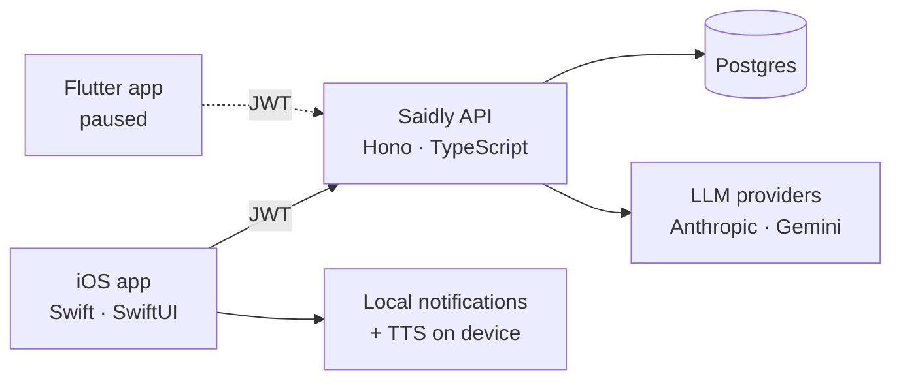

# Saidly

Say tomorrow. Get reminded.

Saidly turns a few sentences about your day — typed tonight, spoken later — into a
structured plan with timed reminders. "Tomorrow wake up at 7, call Marko about the
invoice before noon, harmonica practice from 19:00 to 20:30" becomes three items,
each with a time, and each one nudges you when it matters — as a notification, or
read aloud if sound is on.

> Status: **v0.1 in progress** — text input only, native iOS client + own backend.
> Voice, on-device AI and Siri come in later phases (see roadmap). The Flutter
> client is paused, not removed — see `docs/decisions/003-native-ios-first.md`.

## Why

Most task apps make you fill in forms. Planning a day is something people already
do in their head, in full sentences, usually in the evening. Saidly meets that habit
where it is: one text box (later one microphone), one confirmation screen, done.

It is also a deliberately complete product: mobile app, own backend, LLM
integration with cost tracking, evaluation, and later a hybrid on-device/cloud AI
layer. It exists to be used, and to show how such a product is built end-to-end.

## How it works



1. You sign in (Firebase Auth) and type your plan for tomorrow.
2. The app sends the text to `POST /parse`. The API asks an LLM for a strictly
   typed JSON plan (title, start, end, priority), validates it with Zod, stores it
   and records the tokens and cost of the call.
3. You confirm or fix the plan. The app schedules local notifications on the
   device, so reminders fire even offline.
4. At the right moment you get a notification — or a spoken reminder if sound is on.

## Repository layout

```
saidly/
├── apps/
│   ├── api/        Hono + TypeScript + Drizzle + Postgres   (Node 22)
│   │   └── eval/   English and Croatian parser cases, run by `pnpm eval`
│   ├── ios/        Native iOS app — Swift 6, SwiftUI       (Xcode 26, iOS 26+)
│   └── flutter/    Flutter app — paused                    (Flutter 3.x)
├── docs/           Architecture notes, decisions, provider comparison
├── CLAUDE.md       Working rules for AI coding agents
└── README.md
```

## Running locally

**Prerequisites:** Node 22+, pnpm, Docker, Flutter 3.x, a Firebase project (Authentication enabled), an API
key for at least one LLM provider.

```bash
# API
cd apps/api
cp .env.example .env          # fill in DATABASE_URL, FIREBASE_PROJECT_ID, LLM keys
docker compose up -d          # Postgres 16
pnpm install
pnpm db:migrate
pnpm dev                      # http://localhost:3000/health and /ready

# Mobile
cd apps/flutter
cp .env.example .env          # API_BASE_URL (localhost:3000 or the deployed URL
                              # below); Firebase config via flutterfire configure
flutter pub get
flutter run
```

```bash
# Tests and parser evaluation
cd apps/api
pnpm test                     # Vitest
pnpm eval                     # accuracy, cost and latency per provider
```

## Deployment

The API runs on Railway, built from `apps/api/Dockerfile` and configured by
`apps/api/railway.json`. Every merge into `main` deploys: Railway builds the
image, runs `node dist/db/migrate.js` as a pre-deploy step, waits for `/ready`
to answer, and only then moves traffic over. A failed migration stops the
release and leaves the running version serving.

```bash
curl https://divine-magic-production-a0d3.up.railway.app/health
# {"ok":true,"version":"0.1.0"}     the process is up
curl https://divine-magic-production-a0d3.up.railway.app/ready
# {"ready":true}                    and the database answers
```

The two are deliberately different questions. `/health` touches nothing, so it
stays green while the database is unreachable or empty — which is exactly what
happened here for a week before anyone called a route that reads. `/ready` runs
`select 1`, and it is what the platform waits for.

Three variables are set on the service: `DATABASE_URL` (a reference to the
Postgres service, so traffic stays on the private network),
`FIREBASE_PROJECT_ID` and `ANTHROPIC_API_KEY`. `SENTRY_DSN` is optional but set;
`PORT` comes from Railway and `NODE_ENV` from the image.

## Roadmap

- **v0.1 (Oct 2026)** — text → plan → reminders. API deployed with CI/CD, auth,
  cost tracking, multi-provider parsing, eval set. Native iOS client with
  sign-in, plan entry, confirmation, local notifications.
- **v0.2** — voice input, streaming responses, offline cache and sync, spoken
  reminders and a morning "here's your day" summary.
- **v0.3** — on-device parsing on iPhone (Apple Foundation Models + SpeechAnalyzer)
  with cloud fallback.
- **v0.4** — App Intents ("Hey Siri, Saidly…"), AlarmKit wake-up alarms, widget,
  Live Activity.
- **v1.0** — App Store release with subscriptions. Android (Flutter client
  resumed, Gemini Nano where available) is decided after v0.3.

**Voice in v0.2 and Siri in v0.4 are separate pieces of work, not one.** Voice
input inside the app means recording, permissions and transcription. The Siri
path involves none of that: Siri transcribes and hands an App Intent a finished
string, so the app never touches the microphone. Building one brings the other
no closer, and the Siri path may well be the smaller job.

With a native client the intent can call the same Swift code the app uses.
The first version still opens the app with the transcribed text, which keeps
the confirmation screen where the user sees what the parser understood.
Parsing and scheduling without opening the app is worth it only once the eval
numbers say the parser can be trusted unseen.

## Decisions

Short notes on non-obvious choices live in `docs/decisions/`. The first ones:

- Own backend instead of BaaS-only: the LLM gateway (auth, rate limits, cost per
  user, provider switching) is the part clients actually pay for.
- Local notifications instead of push for reminders: they work offline and need no
  server round-trip at the exact minute.
- Text before voice: relative time expressions and reliable scheduling
  are the hard problems; both can be solved with typed input first.

## License

MIT — see `LICENSE`.
